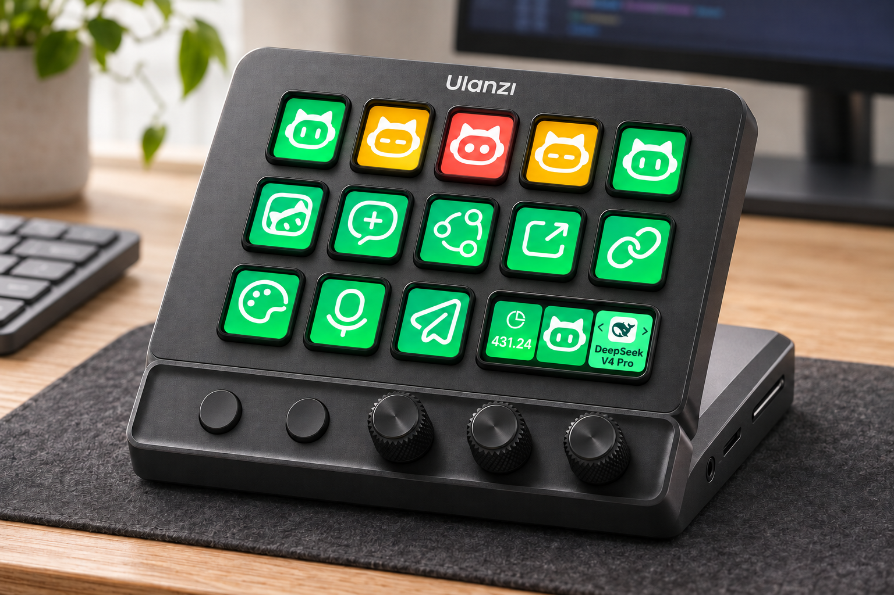

# WorkBuddy Micro

**Control WorkBuddy Desktop with keys and dials in Ulanzi Studio.**

[中文说明](README.zh.md) · [Installation](#installation) · [Action guide](com.ulanzi.ulanzistudio.workbuddy.ulanziPlugin/README.md) · [Report an issue](https://github.com/UlanziTechnology/WorkBuddyMicro/issues)

WorkBuddy Micro brings recent conversations, live session status, model selection, voice input, message sending, themes and account credits to your Ulanzi device. Ulanzi Studio manages the device and layout; the plugin connects directly to the local WorkBuddy client.



D200X desktop visualization with illustrative session states; not a physical-device test photo.

## What it does

| Action | Control | Behavior | Connection |
| --- | --- | --- | --- |
| Launch WorkBuddy | Key | Start or restart WorkBuddy with local debugging enabled; bring it forward when already connected | CDP setup |
| New Task | Key | Open an unsent draft with a reusable prompt and optional task parameters | Deep link |
| Open Page | Key | Jump to a page or a specific task ID | Deep link |
| WorkBuddy Task 1–5 | Five key actions | Show recent conversations and their individual states; press to open the conversation displayed | CDP |
| Model Switch | Dial | Show the current model and its icon; turn to choose an available model and apply after a short pause, or press to apply | CDP |
| Current Session Status | Dial | Show live status; turn to select a permission or question option, then press to act | CDP |
| Voice Input | Key | Start or finish native voice input; show confirmed recording state with a blinking red dot | CDP |
| Send Message | Key | Send the current draft, or stop the running response when Stop is shown | CDP |
| Switch Theme | Key | Apply a chosen image and editable colors; press again to restore the native theme | CDP |
| Credit Balance | Key or dial | Show remaining account credits; refresh every 30 seconds or on press | CDP |

Deep-link actions work without CDP setup. Live state and controls use **CDP only**, with no hook fallback, separate Bridge service or runtime npm dependencies. WorkBuddy remains responsible for authentication, model access, permissions and task execution.

## Requirements

- WorkBuddy Desktop installed and signed in.
- Windows 10 or later, or macOS 12 or later, as declared in the plugin manifest.
- Ulanzi Studio **3.4.8 or later**. Dial actions require a host with custom Encoder layout support.
- A compatible Ulanzi device and the corresponding Keypad or Encoder surface. D200, D200H and D200X are intended device families; actual dial availability depends on the hardware and Studio version.
- Node.js 20 or later for development checks. Normal use relies on Studio's host runtime.

Deep-link actions offer `workbuddy://` for the domestic client and `workbuddy-ai://` for the overseas client; this selection is shared across plugin actions. **CDP features currently target the domestic WorkBuddy client. WorkBuddy AI is outside the current CDP support scope.**

## Installation

### 1. LLM / Agent installation

Give an LLM or coding agent this request:

```text
Install WorkBuddy Micro from https://github.com/UlanziTechnology/WorkBuddyMicro
for my local Ulanzi Studio. Check the existing installation first, preserve
my layouts and settings, and report plugin installation and CDP connectivity
separately. Follow the repository README's installation instructions.
```

The agent should:

1. Read applicable repository instructions, identify the desktop OS and locate Studio's actual plugin directory using the paths below as starting points.
2. Inspect existing plugin manifests. WorkBuddy Micro is installed when UUID `com.ulanzi.ulanzistudio.workbuddy` is present and its `CodePath` (`plugin/app.js`) resolves to an existing file. Check the version, asset paths and inspector paths as well; folder presence alone is insufficient.
3. For a missing or broken installation, obtain the repository and validate the complete `com.ulanzi.ulanzistudio.workbuddy.ulanziPlugin` folder. With Node.js 20 or later available, run `npm run check` inside that folder. A valid installation can be reused; update it when requested.
4. Quit Studio before replacing plugin files. Back up an existing destination outside the scanned Plugins directory, then install the complete plugin folder as described under Manual installation. Preserve other plugins, device layouts and user settings.
5. Reopen Studio and verify that the WorkBuddy category and the intended key/dial actions are recognized. Connect CDP through the plugin's connection panel after active WorkBuddy tasks have been saved.
6. Report the installed path, manifest version and entry-point check, Studio recognition, CDP connection and any physical-device checks separately. An installed folder does not establish a live connection or successful hardware input.

### 2. Manual installation

Install WorkBuddy Desktop and Ulanzi Studio first; see [Requirements](#requirements) for the supported scope. The plugin runs from the complete `.ulanziPlugin` folder using Studio's Node runtime.

**Option A — import a plugin ZIP**

Import a WorkBuddy Micro plugin ZIP into Ulanzi Studio. To create one from the repository:

```sh
git clone https://github.com/UlanziTechnology/WorkBuddyMicro.git
cd WorkBuddyMicro
git archive --format=zip --output=com.ulanzi.ulanzistudio.workbuddy.ulanziPlugin.zip HEAD com.ulanzi.ulanzistudio.workbuddy.ulanziPlugin
```

This packages the **committed** plugin folder, including its manifest, source, assets and inspectors. Keep the `.ulanziPlugin` folder at the archive root and retain the `.zip` extension. Git is needed for this packaging command; Node.js is only needed for development checks.

**Option B — install the source folder**

Clone the repository with the commands above, or download and extract its [source archive](https://github.com/UlanziTechnology/WorkBuddyMicro/archive/refs/heads/main.zip). Quit Studio and copy the complete `com.ulanzi.ulanzistudio.workbuddy.ulanziPlugin` folder into Studio's Plugins directory:

| Platform | Default Plugins directory |
| --- | --- |
| macOS | `~/Library/Application Support/Ulanzi/UlanziDeck/Plugins/` |
| Windows | `%APPDATA%\Ulanzi\UlanziDeck\Plugins\` |

Confirm the directory used by your Studio installation before copying. `manifest.json` must be directly inside `Plugins/com.ulanzi.ulanzistudio.workbuddy.ulanziPlugin/`, with `plugin/app.js` and the asset/inspector folders beneath it. Copy the plugin folder itself, rather than the repository root or an extra enclosing folder. For an update or repair, keep a backup of the old folder outside Plugins before replacing it. Reopen Studio after installation.

### 3. Configure your layout

Drag actions from the **WorkBuddy** category onto keys or dials in Studio. Select an action to configure it in the property inspector. Start with **Launch WorkBuddy**, **WorkBuddy Task 1–5** and, on an Encoder surface, **Model Switch** or **Current Session Status**.

New Task and Open Page work through deep links immediately after configuration. Live task status and controls require the CDP connection below.

### 4. Connect live controls

Use the domestic WorkBuddy client for CDP features. Save active work in WorkBuddy first. Press **Launch WorkBuddy**, or select **Restart WorkBuddy** in a CDP action's connection panel. The plugin starts the client with a debugging endpoint at `127.0.0.1:9223`. The panel changes to **Connected** when ready; use **Check again** to refresh it.

When already connected, the Launch key brings WorkBuddy to the foreground. When disconnected, it starts or restarts the selected client. **On Windows, restarting ends the selected installation's processes, including tray processes, and can interrupt tasks.** The setup panel handles launching and connection detection without a terminal command.

Open a conversation with its composer visible to use model, voice and send controls. WorkBuddy's microphone permissions and enabled controls still apply. WorkBuddy AI is outside the current CDP support scope.

### 5. Verify installation

- **Plugin:** the WorkBuddy category appears in Studio; configured actions show their property inspectors and images.
- **Connection:** the CDP panel reports Connected. For a read-only diagnostic, `http://127.0.0.1:9223/json/list` should include a WorkBuddy renderer; an HTTP response alone does not prove the plugin has connected to the correct client.
- **Actions:** a task key opens the displayed conversation, and an assigned model dial reflects the active composer's model. Check physical key/dial input on your device when available.

If the category is missing, quit and reopen Studio, check the folder nesting and manifest paths, and inspect `debug.log` in the installed plugin folder. For connection failures, use [Troubleshooting](#troubleshooting). See the [action guide](com.ulanzi.ulanzistudio.workbuddy.ulanziPlugin/README.md) for prompt templates, approval selection, themes and credit behavior.

## Session feedback and interaction

- Status artwork distinguishes idle, working, completed, approval/reply needed, error and disconnected. Completed uses check-mark eyes, approval uses yellow pause eyes, and error uses red cross eyes.
- Task slots come from the recent conversations currently loaded by WorkBuddy. They are not a complete history search or permanently pinned slots. Pressing opens the conversation that was displayed on that key.
- Completion alerts require WorkBuddy's conversation-list notification. A transition from working to idle alone does not trigger a completion alert.
- The session dial presents available permission actions, such as allow once, allow for this conversation and deny. Standard question panels use their actual choices and available paging, submit and skip controls.
- Question options appear in three vertical rows with a highlighted selection. Longer lists scroll as you turn; long labels are truncated. Free-text answers are entered in WorkBuddy after selecting **Other**.
- Custom dialogs may need additional adapters. The plugin does not claim to handle every popup.
- Model cards retain the last known model during temporary read failures, including hidden composers during approval. Offline cards use a gray background and an `N` placeholder if no model has been read.

## Troubleshooting

| Symptom | What to check |
| --- | --- |
| CDP stays disconnected | Save work, use Restart WorkBuddy, then Check again. Verify the selected client is installed. Another process occupying port 9223 prevents a restart. |
| Windows client is not found | Set `WORKBUDDY_EXE` to the intended client's full executable path, then restart Studio. Discovery also checks running processes, protocol registration, common install paths and uninstall registry entries. |
| Model, microphone or send control is unavailable | Open the active conversation's composer and check the same control inside WorkBuddy. Press to send when the native send control is ready, or to stop when the Stop control is enabled. |
| No conversation appears in a task slot | Open or create a conversation in WorkBuddy and let its recent list load. |
| Credits show a gray dash | Check CDP and account availability. Transient read failures retain the last valid balance; disconnecting clears it. Press to retry. |
| A theme needs resetting | Press the same theme key again, or use Restore native WorkBuddy theme in its inspector. |
| A page does not open as expected | Page routes depend on the client version, region and enabled features; some destinations may fall back or be unavailable. |

For diagnosis, the plugin writes `debug.log` inside its installed plugin folder and sends log messages to Studio. Review and redact logs and screenshots before sharing them.

## Development

The implementation is CommonJS JavaScript and runs directly under Node 20. No dependency installation or compilation is required.

```sh
cd com.ulanzi.ulanzistudio.workbuddy.ulanziPlugin
npm run check
```

| Location inside the plugin folder | Responsibility |
| --- | --- |
| `plugin/app.js` | Studio connection, action instances, settings, event routing and display delivery |
| `plugin/actions.js` | Key and dial behavior |
| `plugin/deeplink.js` | Client URLs, input validation and prompt placeholders |
| `plugin/workbuddy-cdp.js`, `plugin/question-panel.js` | Local renderer discovery and WorkBuddy state/action adapters |
| `plugin/workbuddy-status.js` | Shared session snapshots and state subscriptions |
| `plugin/enable-cdp.js`, `plugin/windows-workbuddy.ps1` | Platform launch, restart and foreground activation |
| `plugin/*-art.js`, `layouts/`, `assets/` | Rendered graphics, Encoder layouts and artwork |
| `property-inspector/`, `usage-guide/`, `en.json`, `zh_CN.json` | Configuration, connection guide and localization |

Run the syntax check and a Ulanzi plugin validator before packaging changes. Validate affected actions in Studio and WorkBuddy; include device input checks when hardware is available. A static check or simulated dial event is not proof of physical device behavior. Package committed changes using the archive command above.

### Compatibility evidence

Existing project verification records cover macOS with WorkBuddy 5.3.14, Studio 3.4.13 and Node 20.18.0, and Windows launch, reconnect, foreground activation and CDP reads with WorkBuddy 5.9.3, Studio 3.4.13 and Node 20.12.2. These are historical checks, not a certification of every feature in every release. Physical AU05/D200X dial operation requires separate verification.

CDP adapters read WorkBuddy UI and internal renderer state. WorkBuddy updates can change those structures; report the client version when a control stops working.

## Local access and data

The WorkBuddy connection is restricted to loopback `127.0.0.1:9223`. The plugin reads task titles, session state, available models and account credits, and can operate the active client's controls. A local debugging endpoint provides access to the client; keep it local.

Theme images are resized and stored with action settings in Studio. The `{clipboard}` placeholder reads the clipboard when the New Task action is invoked. Normal WorkBuddy cloud requests and account policies remain governed by WorkBuddy.

Upgrading from a hook-based release removes only legacy hook entries named `ulanzi-workbuddy-plugin` from `~/.workbuddy/settings.json`, with a backup before modification. Other hook entries are preserved; fresh installations do not add hooks.

## Contributing and support

Use [GitHub Issues](https://github.com/UlanziTechnology/WorkBuddyMicro/issues) for reproducible bugs and feature requests. Include OS, WorkBuddy and Studio versions, device model, key/dial action, connection status, reproduction steps and expected versus actual behavior. Remove account details, conversation content and private paths from shared material.

Keep pull requests focused, describe the user-visible change, update English and Chinese documentation together, and state which syntax, host and hardware checks were performed. Preserve plugin/action UUIDs and existing user settings when changing behavior. Check the applicable license and asset permissions before reusing or redistributing material.

## Licensing

Third-party license notices are retained in [THIRD_PARTY_NOTICES.txt](com.ulanzi.ulanzistudio.workbuddy.ulanziPlugin/THIRD_PARTY_NOTICES.txt).

The D200X device visualization is subject to the [Ulanzi Device Artwork License](docs/images/LICENSE).

WorkBuddy and Ulanzi names, logos, supplied icons, animations and device artwork remain subject to their respective owners' rights. The third-party notice does not grant a license to all bundled artwork.

**Project license status:** this repository currently has no project-level `LICENSE` file. The third-party MIT notice applies to its attributed material and does not establish an MIT license for the whole project. A project license and the redistribution scope of bundled assets must be established before treating this repository as fully open source.
