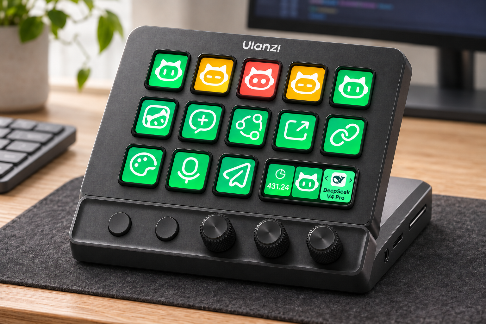

# WorkBuddy Micro

**通过 Ulanzi Studio，用按键和旋钮控制 WorkBuddy 桌面客户端。**

[English](README.md) · [安装](#安装与开始使用) · [功能使用说明](com.ulanzi.ulanzistudio.workbuddy.ulanziPlugin/README.zh.md) · [反馈问题](https://github.com/UlanziTechnology/WorkBuddyMicro/issues)

WorkBuddy Micro 将最近会话、实时状态、模型切换、语音输入、消息发送、主题和账户积分显示在 Ulanzi 设备上。设备连接与布局由 Ulanzi Studio 管理，插件直接连接本机 WorkBuddy 客户端。



D200X 桌面场景与会话状态示意渲染图，非实体设备实测照片。

## 功能介绍

| 功能 | 控件 | 操作与反馈 | 连接方式 |
| --- | --- | --- | --- |
| 启动 WorkBuddy | 按键 | 以本地调试模式启动或重启；已连接时唤醒到前台 | CDP 引导 |
| 新建任务 | 按键 | 根据提示词模板和可选任务参数预填草稿，不自动发送 | 深度链接 |
| 页面直达 | 按键 | 打开指定页面，或按任务 ID 进入会话 | 深度链接 |
| WorkBuddy 任务 1–5 | 五个按键功能 | 显示最近会话及各自状态；按下进入键面上显示的会话 | CDP |
| 模型切换 | 旋钮 | 显示当前模型及图标；旋转选择，停下后自动应用，也可按下应用 | CDP |
| 当前会话状态 | 旋钮 | 显示实时状态；旋转选择审批或问题选项，按下执行 | CDP |
| 语音输入 | 按键 | 开始或结束原生语音输入；根据实际录制状态显示闪烁红点 | CDP |
| 发送消息 | 按键 | 发送当前草稿；显示 Stop 时按下停止当前回复 | CDP |
| 主题切换 | 按键 | 应用自选图片和可调整的配色；再次按下恢复原生主题 | CDP |
| 积分余额 | 按键或旋钮 | 显示账户剩余积分；每 30 秒刷新，也可按下刷新 | CDP |

深度链接功能无需 CDP 引导。实时状态与控制功能**只使用 CDP**，不回退到 hooks，无需独立 Bridge 服务或运行时 npm 依赖。登录、模型权限、审批规则和任务执行仍由 WorkBuddy 负责。

## 使用环境

- 已安装并登录的 WorkBuddy 桌面客户端。
- 插件清单声明支持 Windows 10 及以上、macOS 12 及以上。
- Ulanzi Studio **3.4.8 及以上**。旋钮功能需要支持自定义 Encoder 布局的宿主。
- 具有对应 Keypad 或 Encoder 控件的 Ulanzi 设备。D200、D200H、D200X 为目标设备系列；旋钮是否可用取决于实际硬件和 Studio 版本。
- 开发检查需要 Node.js 20 及以上；日常使用由 Studio 提供宿主运行时。

深度链接功能提供国内客户端 `workbuddy://` 和海外客户端 `workbuddy-ai://` 协议选项，该设置在插件内共享。**CDP 功能当前只面向国内 WorkBuddy 适配，WorkBuddy AI 不在当前 CDP 支持范围内。**

## 安装与开始使用

### 1. LLM / Agent 安装

可以把以下请求交给 LLM 或编程 Agent：

```text
请从 https://github.com/UlanziTechnology/WorkBuddyMicro 为本机 Ulanzi Studio
安装 WorkBuddy Micro。先检查已有安装，保留我的布局和配置，分别报告插件安装
结果与 CDP 连接状态，并按仓库 README 的安装说明操作。
```

Agent 应按以下流程操作：

1. 阅读适用的仓库指引，识别桌面操作系统，并以下表目录为起点确认 Studio 实际使用的插件目录。
2. 检查已有插件清单。清单 UUID 为 `com.ulanzi.ulanzistudio.workbuddy`，且 `CodePath`（`plugin/app.js`）指向的文件存在，才可判定插件已安装；同时检查版本、素材和属性页路径，不能仅凭目录存在判断成功。
3. 缺失或损坏时，获取仓库并校验完整的 `com.ulanzi.ulanzistudio.workbuddy.ulanziPlugin` 目录。有 Node.js 20 及以上环境时，在该目录运行 `npm run check`。已有有效安装可以复用，需要更新时再更新。
4. 替换插件文件前退出 Studio。将已有目标目录备份到 Plugins 扫描目录之外，再按「手动安装」步骤安装完整插件目录，保留其他插件、设备布局和用户配置。
5. 重新打开 Studio，确认 WorkBuddy 分类及所需按键、旋钮功能被识别；保存 WorkBuddy 中的活动任务后，通过插件连接面板连接 CDP。
6. 分别报告安装路径、清单版本与入口文件检查、Studio 识别、CDP 连接及实体设备验证结果。目录安装成功不代表实时连接或硬件输入已验证。

### 2. 手动安装

先安装 WorkBuddy 桌面客户端和 Ulanzi Studio，支持范围见[使用环境](#使用环境)。插件以完整 `.ulanziPlugin` 目录运行，使用 Studio 提供的 Node 运行时。

**方式 A：导入插件 ZIP**

在 Ulanzi Studio 中导入 WorkBuddy Micro 插件 ZIP。也可以从仓库自行打包：

```sh
git clone https://github.com/UlanziTechnology/WorkBuddyMicro.git
cd WorkBuddyMicro
git archive --format=zip --output=com.ulanzi.ulanzistudio.workbuddy.ulanziPlugin.zip HEAD com.ulanzi.ulanzistudio.workbuddy.ulanziPlugin
```

该命令打包**已提交**的插件目录，包含清单、源码、素材和属性页。ZIP 根目录应保留完整的 `.ulanziPlugin` 文件夹，文件后缀保持 `.zip`。此打包命令需要 Git，Node.js 仅用于开发检查。

**方式 B：安装源码目录**

使用上面的命令克隆仓库，或下载并解压[源码压缩包](https://github.com/UlanziTechnology/WorkBuddyMicro/archive/refs/heads/main.zip)。退出 Studio，将完整的 `com.ulanzi.ulanzistudio.workbuddy.ulanziPlugin` 文件夹复制到 Studio 的 Plugins 目录：

| 平台 | 默认 Plugins 目录 |
| --- | --- |
| macOS | `~/Library/Application Support/Ulanzi/UlanziDeck/Plugins/` |
| Windows | `%APPDATA%\Ulanzi\UlanziDeck\Plugins\` |

复制前请确认本机 Studio 实际使用的目录。`manifest.json` 应直接位于 `Plugins/com.ulanzi.ulanzistudio.workbuddy.ulanziPlugin/` 内，其下包含 `plugin/app.js`、素材和属性页目录。复制插件文件夹本身，不要复制整个仓库或多套一层目录。更新或修复时，先将旧目录备份到 Plugins 之外，再替换。安装后重新打开 Studio。

### 3. 配置设备布局

从 Studio 的 **WorkBuddy** 分类将功能拖到按键或旋钮，选中功能后在属性栏配置。建议先添加「启动 WorkBuddy」「WorkBuddy 任务 1–5」，在 Encoder 控件上添加「模型切换」或「当前会话状态」。

「新建任务」「页面直达」配置后即可通过深度链接使用；实时任务状态与控制功能需继续连接 CDP。

### 4. 连接实时控制

CDP 功能请使用国内 WorkBuddy 客户端。先保存 WorkBuddy 中正在进行的工作，再按「启动 WorkBuddy」，或点击 CDP 功能属性栏中的「重启 WorkBuddy」。插件会以调试模式启动客户端，使用本机 `127.0.0.1:9223` 端点，连接成功后属性栏显示「已连接」，可点击「重新检测」刷新。

已连接时，启动键将 WorkBuddy 唤醒到前台；未连接时，启动或重启所选客户端。**Windows 重启会结束所选安装目录下的进程，包括托盘进程，可能中断任务。** 连接面板会完成启动和连接检测，无需手动输入命令。

模型、语音和发送功能需要打开会话输入页；麦克风权限及原生控件的可用条件仍由 WorkBuddy 管理。WorkBuddy AI 不在当前 CDP 支持范围内。

### 5. 检查安装结果

- **插件**：Studio 中出现 WorkBuddy 分类，配置的功能能显示属性栏和图标。
- **连接**：CDP 面板显示「已连接」。可用 `http://127.0.0.1:9223/json/list` 做只读排查，其中应包含 WorkBuddy 渲染页面；仅收到 HTTP 响应不能证明插件已连接到正确客户端。
- **功能**：任务键能进入键面上显示的会话，已配置的模型旋钮能反映当前输入页模型。有设备时，再验证实际按键和旋钮输入。

分类未出现时，退出并重新打开 Studio，检查目录层级、清单路径及安装目录的 `debug.log`。连接失败见[常见问题](#常见问题)。提示词模板、审批选择、主题及余额的具体用法见[功能使用说明](com.ulanzi.ulanzistudio.workbuddy.ulanziPlugin/README.zh.md)。

## 会话状态与交互

- 状态图分别显示待机、运行、完成、审批/待回答、错误和未连接。完成为勾眼，审批为黄色暂停眼，错误为红叉眼。
- 任务位取自 WorkBuddy 当前已加载的最近会话，不是完整历史搜索，也不是永久固定绑定。按下进入当时键面上显示的会话。
- 完成提醒必须有 WorkBuddy 会话列表的通知标记；仅从运行变为空闲不会触发完成提醒。
- 当前会话旋钮根据原生审批显示可用操作，例如允许一次、允许此次会话和拒绝。标准问题框显示实际选项，并支持原生提供的翻页、提交和跳过。
- 问题选项纵向显示三行并突出当前选择；超过三项时随旋转滚动，长文字省略。选择「其他」后，在 WorkBuddy 中输入自由文本。
- 自定义弹窗可能需要单独适配，无法承诺覆盖所有弹窗。
- 审批遮挡输入区等短暂读取失败时，模型卡片保留上次有效模型。离线显示灰色背景，尚未读取到模型时使用字母 `N` 占位。

## 常见问题

| 现象 | 检查方法 |
| --- | --- |
| CDP 一直未连接 | 保存工作后点击「重启 WorkBuddy」，再「重新检测」；确认客户端已安装。9223 端口被其他进程占用时不会重启。 |
| Windows 未找到客户端 | 将 `WORKBUDDY_EXE` 设为目标客户端的完整 EXE 路径，再重启 Studio。自动定位也会检查运行进程、协议注册、常见安装位置和卸载注册表。 |
| 模型、语音或发送不可用 | 打开当前会话输入页，并检查 WorkBuddy 中对应控件。原生发送按钮就绪时按下发送；停止按钮可用且显示 Stop 时按下停止。 |
| 任务位没有会话 | 在 WorkBuddy 打开或创建会话，等待最近会话列表加载。 |
| 积分显示灰色横线 | 检查 CDP 和账户状态。临时读取失败保留有效余额，断开连接后清空；按下可重新读取。 |
| 想恢复默认主题 | 再按一次同一个主题键，或在属性栏点击「恢复 WorkBuddy 原生主题」。 |
| 页面直达不符合预期 | 页面取决于客户端版本、地区和已启用能力，部分入口可能回退或不可用。 |

插件会在安装目录内写入 `debug.log`，同时向 Studio 发送日志。分享日志和截图前，请检查并隐藏敏感信息。

## 开发

实现采用 CommonJS JavaScript，可直接运行于 Node 20，无需安装依赖或编译。

```sh
cd com.ulanzi.ulanzistudio.workbuddy.ulanziPlugin
npm run check
```

| 插件目录内的位置 | 职责 |
| --- | --- |
| `plugin/app.js` | Studio 连接、功能实例、配置、事件分发和显示下发 |
| `plugin/actions.js` | 按键和旋钮行为 |
| `plugin/deeplink.js` | 客户端 URL、输入校验和提示词占位符 |
| `plugin/workbuddy-cdp.js`、`plugin/question-panel.js` | 本地渲染进程定位，以及 WorkBuddy 状态和操作适配 |
| `plugin/workbuddy-status.js` | 共享会话快照和状态订阅 |
| `plugin/enable-cdp.js`、`plugin/windows-workbuddy.ps1` | 各平台的启动、重启和前台唤醒 |
| `plugin/*-art.js`、`layouts/`、`assets/` | 图像绘制、Encoder 布局和素材 |
| `property-inspector/`、`usage-guide/`、`en.json`、`zh_CN.json` | 属性配置、连接引导和本地化 |

修改后应运行语法检查和 Ulanzi 插件校验器，再打包。对受影响功能在 Studio 与 WorkBuddy 中验证，有设备时补充实体输入验证。静态检查或模拟旋钮事件不能证明真机行为。提交后可使用上面的归档命令打包。

### 兼容性记录

现有项目记录包含 macOS 下 WorkBuddy 5.3.14、Studio 3.4.13、Node 20.18.0 的验证，以及 Windows 下 WorkBuddy 5.9.3、Studio 3.4.13、Node 20.12.2 的启动、重连、前台唤醒和 CDP 读取验证。这些是历史记录，不代表每一版本的全部功能都已验证。AU05/D200X 实体旋钮仍需单独验证。

CDP 适配依赖 WorkBuddy 界面和内部渲染状态，客户端更新可能改变相关结构。反馈控制失效时请提供客户端版本。

## 本地访问与数据

WorkBuddy 连接限定为本机回环 `127.0.0.1:9223`。插件读取任务标题、会话状态、可用模型和账户积分，并可操作当前客户端控件。调试端点能够访问客户端，请保持仅本机可达。

主题图片经缩放后保存在 Studio 功能配置中；调用新建任务功能时，`{clipboard}` 占位符会读取剪贴板。WorkBuddy 自身的云端请求和账户规则仍由 WorkBuddy 管理。

从 hooks 旧版升级时，插件只清理 `~/.workbuddy/settings.json` 中名为 `ulanzi-workbuddy-plugin` 的旧条目，修改前先备份。其他 hooks 保留，新安装不会添加 hooks。

## 贡献与反馈

欢迎通过 [GitHub Issues](https://github.com/UlanziTechnology/WorkBuddyMicro/issues) 提交可复现的问题和功能建议。请提供操作系统、WorkBuddy 与 Studio 版本、设备型号、按键或旋钮功能、连接状态、复现步骤，以及预期与实际结果；分享资料时移除账户信息、会话内容和私人路径。

PR 应聚焦单一问题，说明用户可见变化，同步中英文文档，并列明已进行的语法、宿主和硬件检查。调整功能时保留插件及功能 UUID、兼容已有用户配置。复用或分发材料前，请检查适用许可和素材授权。

## 授权说明

第三方许可声明保留在 [THIRD_PARTY_NOTICES.txt](com.ulanzi.ulanzistudio.workbuddy.ulanziPlugin/THIRD_PARTY_NOTICES.txt)。

D200X 设备渲染图适用 [Ulanzi 设备素材许可](docs/images/LICENSE)。

WorkBuddy、Ulanzi 名称、标识、所提供的图标、动画和设备素材仍受各自权利人约束。第三方许可不代表全部内置素材均获授权。

**项目授权现状：** 仓库目前没有项目级 `LICENSE` 文件。第三方 MIT 声明仅适用于其归属材料，不代表整个项目采用 MIT。项目许可证和内置素材的可分发范围需要明确后，才能将仓库视为完整开源项目。
